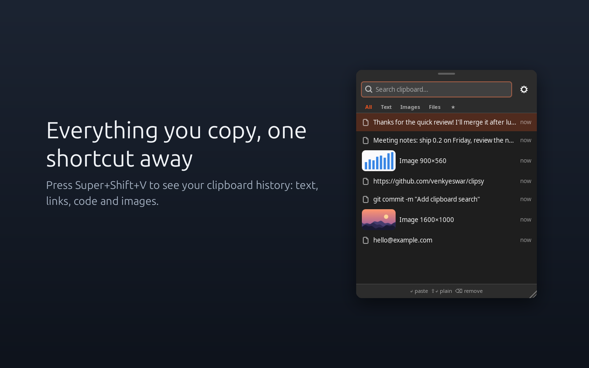

# Clipsy

Clipboard history for Linux. Clipsy remembers what you copy (text, rich text,
images and files), lets you search it, and pastes any earlier item again with
a keystroke.



[](https://snapcraft.io/clipsy)

```
sudo snap install clipsy
```

## Install

Download `clipsy_<version>_amd64.deb` from the releases page and install it:

```sh
sudo apt install ./clipsy_<version>_amd64.deb
```

This pulls in GTK 4 and libadwaita from Ubuntu's repositories. Clipsy starts
in the background at login (you can turn this off in Settings).

## Usage

Press **Super+Shift+V** to open the history popup.

- Click an item, or press Enter, to paste it. Shift+Enter pastes plain text.
- Type to search. Filter by type with the tabs (All, Text, Images, Files, Pinned).
- Pin items you use often, or remove items you do not want to keep.
- Right-click an item for more actions.

From a terminal:

```sh
clipsy toggle      # show or hide the popup
clipsy settings    # open Settings
clipsy pause       # stop recording
clipsy resume      # start recording again
clipsy clear       # clear history (pinned items are kept)
clipsy quit        # stop Clipsy
```

## Privacy

Clipsy works entirely on your machine. History is stored locally, and Clipsy
makes no network connections, needs no account, and sends no telemetry.

## Build from source

You need a Rust toolchain (stable) and these packages (Ubuntu 24.04):

```sh
sudo apt install build-essential pkg-config libgtk-4-dev libadwaita-1-dev libx11-dev
```

Then:

```sh
cargo build --release -p clipsy-app
./target/release/clipsy
```

To build the .deb:

```sh
cargo install cargo-deb --locked
packaging/build-deb.sh
```

## Known limits

- X11 only for now. Wayland sessions (for example, the default GNOME Wayland
  session) are not supported yet.
- Tested on Ubuntu 24.04 with GNOME Shell 46.

## License

GPL-3.0-or-later. See [LICENSE](LICENSE).

## Ubuntu App Center (Snap Store)

The `snap/` folder holds the Snap Store packaging. To build and publish:

```bash
sudo snap install snapcraft --classic
snapcraft                      # builds clipsy_0.1.0_amd64.snap (needs LXD or Multipass)
snapcraft login                # your Snap Store account
snapcraft register clipsy      # reserve the name once
snapcraft upload --release=edge clipsy_0.1.0_amd64.snap
```
Promote from `edge` to `beta`, `candidate` and `stable` with `snapcraft release`.
